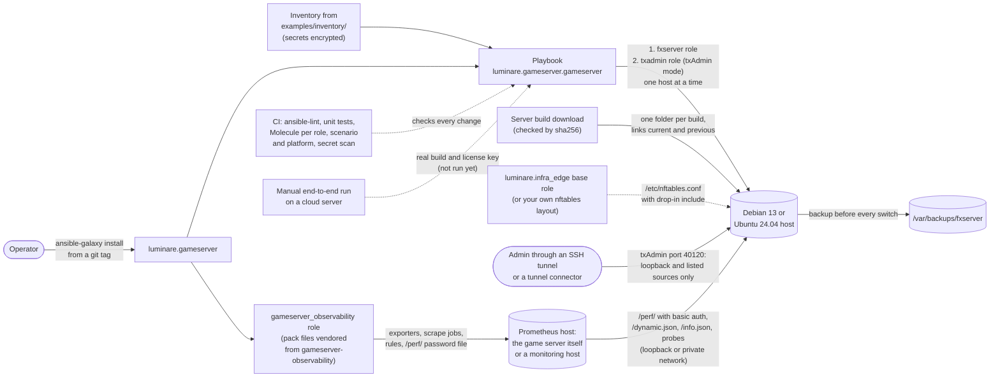

<!-- header:begin: brand-repos 0.1.0, variant studio, files in https://raw.githubusercontent.com/luminare-dev/ansible-collection-gameserver/main/docs/brand/; the project-page sync drops this block -->
<picture>
  <source media="(prefers-color-scheme: dark)" srcset="https://raw.githubusercontent.com/luminare-dev/ansible-collection-gameserver/main/docs/brand/readme-header-dark.svg">
  <source media="(prefers-color-scheme: light)" srcset="https://raw.githubusercontent.com/luminare-dev/ansible-collection-gameserver/main/docs/brand/readme-header-light.svg">
  
</picture>

<!-- byline:studio -->
*a [Luminare Development](https://luminare.tech/open-source/ansible-collection-gameserver/) open-source project*
<!-- /byline:studio -->
<!-- byline:personal
*by [ItsPaulAT](https://github.com/ItsPaulAT) · [project page](https://luminare.tech/open-source/ansible-collection-gameserver/)*
/byline:personal -->
<!-- header:end -->

# luminare.gameserver

Ansible roles that install, configure, update and back up game servers, for FiveM/RedM servers (FXServer).

[](https://github.com/luminare-dev/ansible-collection-gameserver/actions/workflows/ci.yml)
[](https://github.com/luminare-dev/ansible-collection-gameserver/releases)
[](LICENSE)
[](https://scorecard.dev/viewer/?uri=github.com/luminare-dev/ansible-collection-gameserver)

## Why

Running a FiveM or RedM server (FXServer) on Linux by hand is a list of steps that are easy to get
wrong: download a server build, create a service user and a systemd unit, keep the admin port off
the internet, keep the license key out of git, update every few weeks and keep a way back, and
notice when the server is down or lagging. This Ansible collection turns that list into three
roles and a playbook that combines the first two, and it holds them to the same test bar: Molecule
scenarios that CI runs on Debian 13 and Ubuntu 24.04 in systemd containers with an idempotence
check (including the playbook with its example inventory), ansible-lint with its production
profile, and a secret scan that recognises server license keys. The third role adds the game
servers to an existing Prometheus with the metrics, alerts and dashboard of the
[gameserver-observability](https://github.com/luminare-dev/gameserver-observability) pack,
collected from outside the server process and as counts only.

### Why not an existing collection or a manual install

- **[dukex.fivem](https://github.com/dukex/ansible-fivem-collection)** (MIT, version
  1.0.0-rc2) covers more of the host than this collection: a UFW firewall, an nginx reverse proxy
  with an asset cache, MariaDB, system tuning and a git deploy of the server data. On 2026-10-21
  its runtime role downloaded the build without a checksum and unpacked it over the previous one,
  so there is no second build on disk to switch back to; it ran txAdmin and wrote txAdmin's own
  `config.json` instead of using the `TXHOST_*` variables of txAdmin 8; and the repository had no
  Molecule scenarios or CI workflows. It suits a host where those extra parts should come from one
  collection. This collection focuses on checked builds with an automatic rollback, backups before
  every switch, txAdmin settings as code and tests on every change; the firewall layout comes from
  [luminare.infra_edge](https://github.com/luminare-dev/ansible-collection-infra_edge) or your own.
- **A manual install with txAdmin** (download a build, start it, finish txAdmin's web setup and
  deploy a recipe) is the documented way and the quickest for one server, and txAdmin's recipes
  install a framework with its resources, which this collection does not. The parts around it
  stay manual: the service user and unit, a checked download, port 40120 kept off the internet,
  the license key kept out of git, backups and an update with a way back. With
  `fxserver_mode: txadmin` the roles do those parts and leave the web setup and recipes to
  txAdmin.

## Quickstart

Install the collection from a release tag with `ansible-galaxy` (needs `git` on the controller):

<!-- x-release-please-start-version -->
```bash
ansible-galaxy collection install git+https://github.com/luminare-dev/ansible-collection-gameserver.git,v0.1.0
ansible-galaxy collection list luminare.gameserver
```
<!-- x-release-please-end -->

Then copy the example inventory from the installed collection, set your host in
`inventory/hosts.yml`, replace the `CHANGE_ME_` placeholders in
`inventory/group_vars/gameservers/secrets.yml` and encrypt that file, and run the playbook (add
the option your encryption needs, for example `--ask-vault-pass`). The host needs the firewall
layout of the `luminare.infra_edge` base role first ([Installation](docs/install.md#run-the-playbook)):

```bash
cp -R ~/.ansible/collections/ansible_collections/luminare/gameserver/examples/inventory ./inventory
ansible-playbook -i inventory luminare.gameserver.gameserver
```

Each release also carries the collection tarball and `SHA256SUMS`; see
[Installation](docs/install.md) for that path and for a `requirements.yml` entry.

## How it works



| Role | What it does |
|---|---|
| [`fxserver`](roles/fxserver/README.md) | Installs a server build checked against its sha256 and runs it as a hardened systemd unit (user `fxserver`, `/opt/fxserver`), directly with `server.cfg` or under txAdmin (`fxserver_mode`); switches builds with one rename, checks the server after every switch and rolls a failed update back; backs up server-data and txData (zstd tar) before every switch and optionally every night; writes `secrets.cfg` (0600; `/perf/` always behind basic auth, with a random password when none is set), the game port drop-in `45-fxserver.nft`, a journald retention and textfile metrics. |
| [`txadmin`](roles/txadmin/README.md) | Configures txAdmin, the admin panel shipped with the build, through `TXHOST_*` variables in `/etc/fxserver/txadmin.env` (root, 0600) and the unit drop-in `fxserver.service.d/10-txadmin.conf`: port, optional default account (bcrypt hash) and API token, slot limit, quiet mode; never a loopback `TXHOST_INTERFACE`, never txAdmin's own files. Writes `40-txadmin.nft` (port 40120 from loopback and listed sources only), and its observability toggle puts `/perf/` basic auth into `secrets.cfg`. |
| [`gameserver_observability`](roles/gameserver_observability/README.md) | Adds game servers to an existing Prometheus on the same host or a monitoring host, with the files of the [gameserver-observability](https://github.com/luminare-dev/gameserver-observability) pack 0.1.0 vendored into the role: json_exporter and blackbox_exporter from their official releases (pinned version and sha256) as hardened units on loopback or a private address, the pack's scrape jobs for every game server, its recording and alerting rules (checked with promtool), the `/perf/` password as a `password_file` (0640), the drop-in `50-observability.nft` and optionally the dashboard "Game server overview" for Grafana. Reloads Prometheus and checks that it loaded the jobs and rules. Counts only: never `players.json`. |

- **Playbook:** `luminare.gameserver.gameserver` ([`playbooks/gameserver.yml`](playbooks/gameserver.yml))
  runs the `fxserver` role and, with `fxserver_mode: txadmin`, the `txadmin` role on the group
  `gameservers`, one host at a time, and stops at the first host that fails. In txAdmin mode it
  first checks the firewall layout that the `txadmin` role needs, because txAdmin listens on port
  40120 from the moment the `fxserver` role starts it until the `txadmin` role's drop-in is
  loaded.
  [`examples/inventory/`](examples/inventory/) holds one host with documentation addresses and
  `CHANGE_ME_` placeholders for every secret, which the roles refuse.
- **Roles** go into `roles/<role>/`, each with a Molecule scenario in
  `roles/<role>/molecule/default/` and optional further scenarios (`fxserver` has `upgrade`); a
  role directory without a default scenario fails the `plan` job and the unit tests. The tests
  use a fake server build (`tests/fake-artifact/`), never a real one. The `txadmin` role's
  `playbook` scenario runs the playbook with the example inventory, changing only the
  placeholders and the download, and checks that the unchanged example and a firewall layout
  without the drop-in include are refused. The `gameserver_observability` scenario runs the fake
  build, Prometheus 3.15.0 (installed with the `prometheus.prometheus` collection) and the role on
  one host and checks the result through Prometheus' API.
- **Pack files:** `roles/gameserver_observability/files/pack/` holds the files of the
  gameserver-observability pack's 0.1.0 release, with their version, source commit, release tag,
  the release archive's sha256 and every file's sha256 in `manifest.json`.
  `scripts/check_vendored_pack.py` checks them against the manifest and byte for byte against
  that release's archive, which it downloads and checks against the release's `SHA256SUMS`
  ([ADR 0018](docs/adr/0018-vendor-the-observability-pack-and-check-it-against-its-release.md)).
- **Tests:** every scenario reuses one base configuration (`.config/molecule/config.yml`) and one
  test image (`molecule/resources/Dockerfile.j2`: `debian:trixie` or `ubuntu:24.04`, pinned by
  digest, with systemd as PID 1). Instance names start with `gs-`. The sequence is dependency,
  syntax, create, prepare, converge, idempotence (must report `changed=0`), verify and destroy;
  the `upgrade` scenario adds a side_effect step for the update and rollback.
- **CI:** the `plan` job builds a matrix with one entry for each scenario of each role on each
  platform (Debian 13 and Ubuntu 24.04). Each `molecule-scenario (<role>, <scenario>, <platform>)`
  job runs `molecule test --scenario-name <scenario> --platform-name <instance>` with a 30-minute
  limit, on pull requests, by hand and every Tuesday. The `molecule` job reports one result for
  all of them; it fails when a scenario fails and passes when there is none. The `lint-test` job runs ansible-lint
  (production profile), the check of the vendored pack files and the unit tests through
  `scripts/test.sh`. The Python tools come from the hash-pinned `requirements-test.txt`.
- **End-to-end run:** [`.github/workflows/e2e.yml`](.github/workflows/e2e.yml) runs the playbook
  twice per mode with the real build on a cloud server that exists only for the run and checks
  port 40120 from outside ([docs/e2e.md](docs/e2e.md)). It starts only by hand, in the protected
  environment `e2e`, and is skipped until the repository variable `E2E_ENABLED` is `true`.
- **Releases:** release-please tags `vX.Y.Z` and updates the version in `galaxy.yml`. The release
  then attaches the source archive, the collection tarball built by `ansible-galaxy collection
  build` (`luminare-gameserver-X.Y.Z.tar.gz`) and one `SHA256SUMS` file for both. Before anything
  is published, the tarball is installed into an empty folder, and the installed playbook (with
  the installed example inventory) and a play with every installed role must pass
  `--syntax-check` ([`scripts/check_collection_tarball.sh`](scripts/check_collection_tarball.sh);
  a unit test runs it on every pull request too).

### Works with luminare.infra_edge

This collection does not list
[luminare.infra_edge](https://github.com/luminare-dev/ansible-collection-infra_edge) as a
dependency in `galaxy.yml`. The roles here follow that collection's firewall layout, in which the
infra_edge `base` role owns `/etc/nftables.conf` and other roles add drop-in files; the
convention is recorded in
[ADR 0008](docs/adr/0008-soft-dependency-on-the-infra-edge-firewall-layout.md). The `fxserver`
role writes `/etc/nftables.d/45-fxserver.nft` (accept rules for the game port only) when that
directory exists or `fxserver_firewall_manage` is `true`, and checks it with `nft --check`
together with `/etc/nftables.conf` before it replaces the old file. The `txadmin` role does the
same with `40-txadmin.nft` (port 40120 from loopback and `txadmin_firewall_sources` only), and it
stops when it cannot write its drop-in, unless `txadmin_firewall_required` is `false`. The
`gameserver_observability` role writes `50-observability.nft` the same way as the `fxserver`
role, with accept rules for the two exporter ports from `gameserver_observability_firewall_sources`
only (none by default: Prometheus on the same host reaches them over loopback). Each role that
writes a drop-in requires `table inet filter` and the line `include "/etc/nftables.d/*.nft"` in
`/etc/nftables.conf` and stops before any change without them: the nftables package's own
`/etc/nftables.conf` has no such line, so a drop-in would pass `nft --check` but never be loaded.

## Design decisions

The decisions behind this project are recorded as short ADRs in [docs/adr/](docs/adr/):

- [ADR 0001: Record architecture decisions](docs/adr/0001-record-architecture-decisions.md)
- [ADR 0002: Pin every action and downloaded tool](docs/adr/0002-pin-actions-and-downloaded-tools.md)
- [ADR 0003: Secret scanning with the gitleaks binary](docs/adr/0003-secret-scanning-with-the-gitleaks-binary.md)
- [ADR 0004: Draft releases with checksums and provenance](docs/adr/0004-draft-releases-with-checksums-and-provenance.md)
- [ADR 0005: Why git tags and release tarballs instead of a registry install](docs/adr/0005-install-from-git-tags-and-release-tarballs.md)
- [ADR 0006: Why Molecule in systemd containers, one CI job per role and platform](docs/adr/0006-molecule-in-systemd-containers-one-job-per-role-and-platform.md)
- [ADR 0007: Why `requires_ansible` names only tested versions](docs/adr/0007-requires-ansible-from-tested-versions-only.md)
- [ADR 0008: Why a soft dependency on the infra_edge firewall layout](docs/adr/0008-soft-dependency-on-the-infra-edge-firewall-layout.md)
- [ADR 0009: Why one hash-pinned toolchain for lint, Molecule and the release](docs/adr/0009-one-hash-pinned-test-toolchain.md)
- [ADR 0010: Why the secret scan catches license keys of any layout](docs/adr/0010-catch-license-keys-of-any-layout.md)
- [ADR 0011: Why a service user `fxserver` and one directory layout](docs/adr/0011-service-user-fxserver-and-one-directory-layout.md)
- [ADR 0012: Why builds are switched with one rename, checked and rolled back](docs/adr/0012-switch-builds-with-one-rename-check-and-roll-back.md)
- [ADR 0013: Why local backups before every switch, and off-host copies with any tool](docs/adr/0013-local-backups-before-every-switch.md)
- [ADR 0014: Why the tests use a fake build and one CI job per scenario](docs/adr/0014-fake-build-and-one-ci-job-per-scenario.md)
- [ADR 0015: Why txAdmin is configured with environment variables and started by a launcher mode](docs/adr/0015-txadmin-settings-as-environment-variables.md)
- [ADR 0016: Why the admin port test runs in the test container's own network namespace](docs/adr/0016-prove-the-admin-port-closed-in-a-container-network-namespace.md)
- [ADR 0017: Why one playbook, tested with its example inventory, and a manual cloud run](docs/adr/0017-one-playbook-tested-with-its-example-and-a-manual-cloud-run.md)
- [ADR 0018: Why the observability pack is vendored and checked against its release](docs/adr/0018-vendor-the-observability-pack-and-check-it-against-its-release.md)
- [ADR 0019: Why the observability role adds to an existing Prometheus](docs/adr/0019-observability-adds-to-an-existing-prometheus.md)

## Supported versions

| Component | Tested with | Supported |
|---|---|---|
| ansible-core (controller) | 2.21.5 | 2.21 and later (`meta/runtime.yml`: `>=2.21.0`) |
| Python (controller) | 3.12 (the CI runner's version, in `python:3.12-slim`) and 3.14 | 3.12 and later, as ansible-core 2.21 requires |
| Debian 13 "trixie" (managed host) | Molecule image from `debian:trixie`, pinned by digest | primary platform |
| Ubuntu 24.04 "noble" (managed host) | Molecule image from `ubuntu:24.04`, pinned by digest | second platform |
| Server build (`fxserver` role) | pinned default: build 35245, the Recommended build on 2026-10-21, with the sha256 of its official download; Molecule runs a fake build with that number | Linux x86_64 builds; run the current Recommended build ([upgrade guide](docs/upgrade.md#which-build-to-run)) |
| txAdmin (`txadmin` role) | pinned default: txAdmin 8.1.1, shipped with build 35245; Molecule runs a fake txAdmin, and the variable rules were checked against txAdmin 8.1.1's source and by starting it by hand | txAdmin 8 (`TXHOST_*` variables) as shipped with the build |
| Prometheus (`gameserver_observability` role) | 3.15.0, installed in Molecule with the `prometheus` role of `prometheus.prometheus` 0.30.2 | 2.43 and later (`scrape_config_files`), with promtool on the same host |
| Exporters (`gameserver_observability` role) | pinned defaults: json_exporter 0.8.0 and blackbox_exporter 0.29.0 (linux-amd64, sha256 from each release's `sha256sums.txt`); both run in Molecule | the pinned versions; others through the version and sha256 variables, if they read the pack's module files |
| gameserver-observability pack (`gameserver_observability` role) | 0.1.0 (release `v0.1.0`), vendored into the role | the vendored version |
| Grafana (`gameserver_observability` role, optional) | not installed in Molecule: the scenario checks the provisioning files the role writes | the Grafana versions the pack supports (13.2.4) |
| Test tools | ansible-lint 26.10.1, Molecule 26.10.0, molecule-plugins[docker] 26.10.12 | as pinned in `requirements-test.txt` |

Fixes go into the latest minor release only. See the
[security policy](https://github.com/luminare-dev/.github/blob/main/SECURITY.md) for reporting.

## Limitations

- No real license key was used, and no real server build was run here, not even in LAN mode
  (`sv_lan`, which according to the platform documentation skips the license key check). The
  roles and the playbook were verified against the fake server build (`tests/fake-artifact/`)
  only, so whether the hardened unit (`ProtectSystem=strict`, `NoNewPrivileges` and the others)
  suits a real build, whether players can connect and whether a real build refuses `/perf/`
  without credentials are still open.
- The end-to-end run with the real build on a Hetzner Cloud CX23 ([docs/e2e.md](docs/e2e.md):
  two runs per mode with `changed=0`, `/info.json` from the host and from outside, port 40120
  from outside, nothing left afterwards) is committed but has not run: it needs a license key and
  a cloud project, and it stays skipped until `E2E_ENABLED` is set. So there is no terminal
  recording (asciinema) of its two runs with `changed=0` yet either; it can only be made with the
  first run.
- The `txadmin` role is tested with a fake txAdmin. The real txAdmin 8.1.1 was started by hand in
  an isolated container to check its variables, but not under the role's unit, and no game server
  was started through it (that needs a license key, or LAN mode, which was not tried). txAdmin's
  one-time web setup (server data folder and `server.cfg`) is manual, and txAdmin's environment,
  including the API token, is visible to processes of the service user.
- Molecule runs in privileged systemd containers, not on virtual machines or cloud servers. The
  `txadmin` scenario loads both drop-ins into the container's own network namespace and connects
  from a second namespace (port 40120 open to a listed source only, the game port open); the
  `fxserver` and `gameserver_observability` scenarios only validate their drop-ins with
  `nft --check`. None of this replaces a check from outside a real host: port 40120 seen from
  another machine needs a virtual machine or cloud server, which only the end-to-end run provides.
- In txAdmin mode the playbook needs `/etc/nftables.conf` in the layout of the
  `luminare.infra_edge` base role (or `txadmin_firewall_required: false` behind another
  firewall). Neither the playbook nor this collection sets it up; the `playbook` scenario and the
  end-to-end run use a minimal stand-in ([`tests/e2e/prepare.yml`](tests/e2e/prepare.yml)). The
  playbook checks the layout before any change; a play of your own that runs the `fxserver` role
  in txAdmin mode without it leaves port 40120 open on every IPv4 address until the `txadmin`
  role refuses to continue, so set the layout up first.
- Backups stay on the host (`/var/backups/fxserver`); copies elsewhere, for example with restic,
  are up to the operator (paths in the [role README](roles/fxserver/README.md#backups)).
- The `gameserver_observability` role was tested against the fake server only: Prometheus
  scraped synthetic answers of `/perf/`, `/dynamic.json` and `/info.json`. A real server's answers
  (and `/perf/` with and without credentials on a real build) have not been probed yet. Its
  scenario runs the game server, Prometheus and the exporters in one container; the monitoring
  host setup is covered by a second target on the container's private address, not by a second
  host. Grafana is not installed in the tests (only its provisioning files are checked), and no
  alert was delivered anywhere: the role installs no Alertmanager.
- The `gameserver_observability` role installs the pack files of the pack's 0.1.0 release that
  are vendored into it; a newer pack release reaches the role only with a new release of this
  collection. The check of those files against the release archive downloads it from GitHub, so
  the `lint-test` job needs access to github.com
  ([ADR 0018](docs/adr/0018-vendor-the-observability-pack-and-check-it-against-its-release.md)).
- The pack has no metrics from txAdmin's `/host/status` yet (a json_exporter module with the
  `x-txadmin-envtoken` header): its fields have not been read from a real txAdmin, so this role
  does not scrape it.
- The `gameserver_observability` role is not part of the playbook `luminare.gameserver.gameserver`;
  it runs in a play of its own on the Prometheus host ([Installation](docs/install.md#add-the-metrics)).
- A server with a valid license key appears in the public server list unless it runs LAN-only
  (`fxserver_cfg` key `lan: true`, which writes `sv_lan true`; tested with the fake build only).
  According to the platform documentation, `sv_master1 ""` (the default
  `master1_disabled: true`) only disables the connect button and cannot de-list a server, so
  outside LAN mode the name and description of a test server are public too: give it a neutral
  `hostname`, `project_name` and `project_desc`.
- Only ansible-core 2.21 is tested; older releases are not declared as supported.
- Managed hosts other than Debian 13 and Ubuntu 24.04 on x86_64 are not tested.
- The collection is not published on Ansible Galaxy, so `ansible-galaxy collection install
  luminare.gameserver` by name does not work: install it from a git tag or the release tarball
  ([ADR 0005](docs/adr/0005-install-from-git-tags-and-release-tarballs.md)). The `luminare`
  namespace has not been requested on Galaxy. If Galaxy does not grant it, the collection is
  renamed `luminare_dev.gameserver`, which changes every fully qualified name
  (`luminare.gameserver.<role>`) in your playbooks; that rename ships as a breaking change with
  upgrade notes.
- The `molecule` check is not a required check, and pushes to `main` skip the scenarios, so
  `main` itself is tested by the weekly scheduled run or a manual run.

## Results

Measured in this repository on 2026-10-21; the rows marked 2026-10-22 were measured on that day.

| What | Value | How it was measured |
|---|---|---|
| Molecule `fxserver` `default` (2026-10-22) | passed on Debian 13 and Ubuntu 24.04; idempotence `changed=0` on both; the restore of the newest backup as in the runbook checked (owners, modes, `secrets.cfg`, the server answers again); 4 min 10 s for both platforms | `molecule test` in `roles/fxserver` (Molecule 26.10.0, ansible-core 2.21.5), both instances in one run, test images already in the Docker build cache, another scenario running at the same time; wall time of the `molecule test` command |
| Molecule `fxserver` `upgrade` (2026-10-22) | passed on Debian 13 and Ubuntu 24.04, with Ansible connecting as a non-root user with sudo and no `/perf/` password set; idempotence `changed=0` on both; update together with a new server-data commit (the pre-update backup holds the old `server.cfg`), refused switch after a failed backup, five runs stopped at their checks (drop-in directory without `/etc/nftables.conf`, `/etc/nftables.conf` without the drop-in include, a quote, a line break and a resource name in `fxserver_cfg`), automatic rollback of the broken build, rollback by build number, the removed deploy key, and `/perf/` refusing a request without credentials and answering with the random password from `secrets.cfg` all checked; 10 min 46 s for both platforms | `molecule test -s upgrade` in `roles/fxserver`, same tools and method |
| Molecule `txadmin` `default` (2026-10-22) | passed on Debian 13 and Ubuntu 24.04 (fxserver role in txAdmin mode, then the txadmin role); idempotence `changed=0` on both; environment file, drop-ins, token, default account, `/perf/` toggle and journal checked; port 40120 answered a listed source and dropped another, port 30120 stayed open; six refused runs stopped at their checks; 4 min 56 s for both platforms | `molecule test` in `roles/txadmin`, same tools and method |
| Molecule `txadmin` `playbook` (2026-10-22) | passed on Debian 13 and Ubuntu 24.04 (the playbook `luminare.gameserver.gameserver` with the example inventory); idempotence `changed=0` on both; the end-to-end run's host checks in txAdmin mode, the example's settings on the host (environment file, both drop-ins, `server.cfg`, nightly backup timer, `/info.json`, `/perf/` toggle), the refusal of the unchanged example (license key and API token placeholders, no file changed) and the pre-check's refusal of `/etc/nftables.conf` without the drop-in include checked; 6 min 3 s for both platforms, 3 min 49 s for Debian 13 alone as a CI job runs it | `molecule test -s playbook` in `roles/txadmin`, same tools, another scenario running at the same time; the play handles the two instances one after the other (`serial: 1`); then `molecule test -s playbook --platform-name gs-txadmin-playbook-debian13` with no other scenario running |
| Molecule `gameserver_observability` `default` (2026-10-22) | passed on Debian 13 and Ubuntu 24.04 (the fxserver role with `/perf/` basic auth, Prometheus 3.15.0 from `prometheus.prometheus` 0.30.2, then the role with a loopback and a private-address target); idempotence `changed=0` on both; 13 targets up, 6 probes successful, all 7 `fxserver_*` series of the pack for both servers, no player label or metric name, 5 rule groups healthy, `/perf/` refused without and with a wrong password, no `players.json` request; six refused runs (one of them with an `/etc/nftables.conf` without the drop-in include) left the role's files unchanged, a `prometheus.yml` that does not include the role's files was reported, deselected and old rule files were removed; 6 min 51 s on Debian 13 and 8 min 11 s on Ubuntu 24.04 | `molecule test --platform-name <instance>` in `roles/gameserver_observability`, one platform per run as a CI job runs it, same tools, another scenario running at the same time; `ANSIBLE_PIPELINING=True` in the environment; wall time of each `molecule test` command |
| End-to-end run (`e2e.yml`) | not run yet: no license key and no cloud project were used | [docs/e2e.md](docs/e2e.md); the workflow passed actionlint 1.7.12 (with shellcheck 0.9.0 and 0.10.0) and zizmor 1.30.1 without findings |
| Unit tests (2026-10-22) | 204 run: 203 passed, 1 skipped (a check that applies only to the template repository) | `python3 -m unittest discover -s tests` with gitleaks 8.30.1 and markdownlint-cli2 0.23.2 on the PATH, Python 3.14.3; all of them also under Python 3.12.15 (`python:3.12-slim`, in the release build below) |
| ansible-lint (2026-10-22) | 0 failures, 0 warnings in 137 files; profile `production` passed | `ansible-lint` from the repository root, ansible-lint 26.10.1 with ansible-core 2.21.5, with no community collection installed (as in CI) |
| Vendored pack files (2026-10-22) | 12 files of gameserver-observability 0.1.0 equal to the manifest and byte for byte to the files of the release archive `gameserver-observability-0.1.0.tar.gz` (release `v0.1.0`, commit `88543c9a`), whose sha256 matched the release's `SHA256SUMS` and the manifest | `python3 scripts/check_vendored_pack.py`, which downloaded the release's `SHA256SUMS` and archive; the files were copied from that archive with `--update-from` |
| Collection tarball (2026-10-22) | `luminare-gameserver-0.0.0.tar.gz`: 155 entries, about 140.1 kB (1 kB = 1000 bytes); the three roles without their Molecule scenarios (the `gameserver_observability` role with its vendored pack files), the playbook with its pre-check and the example inventory; no `docs/brand/`, scripts, unit tests, end-to-end playbooks, fake build or Molecule files. Installed into an empty folder, the playbook (with the installed example inventory) and a play with all three roles pass `--syntax-check` | `ansible-galaxy collection build` (ansible-core 2.21.5) twice from a fresh copy of the tree, then `tar -tzf` and the file size; the size varies by a few bytes between builds, because the archive stores file and build times; then `scripts/check_collection_tarball.sh` on the tarball (the unit test `tests/test_collection_tarball.py` does the same) |
| Hash-pinned test tools | 45 packages installed, `pip check` clean | `pip install --require-hashes --only-binary=:all: -r requirements-test.txt` in a `python:3.12-slim` container |
| Release build (2026-10-22) | `ansible-collection-gameserver-0.1.0.tar.gz` and `luminare-gameserver-0.1.0.tar.gz`, one `SHA256SUMS` that verifies both; the test-command passed (ansible-lint, the vendored pack check, 204 unit tests with 2 skipped: the template-only check and the markdownlint test, as markdownlint-cli2 is not installed there); the extra-dist-command built the collection tarball and its check passed (install, playbook and all three roles `--syntax-check`); with `galaxy.yml` left at 0.0.0 the step fails (2026-10-21) | `release.yml`'s test-command (with `CI=true`, so with the hash-pinned tools and the pinned gitleaks) and extra-dist-command in `python:3.12-slim` (Python 3.12.15), on a local `v0.1.0` tag with the release-please version edits applied by hand |
| Install paths | git URL with a ref, `requirements.yml` with `type: git`, and the tarball: each installs `luminare.gameserver` | `ansible-galaxy collection install` against a local clone (`file://` URL) and the locally built tarball |

## Documentation and links

- [Installation](docs/install.md) · [Configuration](docs/configuration.md) ·
  [Upgrade](docs/upgrade.md) · [Troubleshooting](docs/troubleshooting.md) ·
  [Runbook](docs/runbook.md) · [End-to-end run](docs/e2e.md) · [ADRs](docs/adr/)
- [Playbook](playbooks/gameserver.yml) and [example inventory](examples/inventory/)
- Role READMEs: [fxserver](roles/fxserver/README.md) · [txadmin](roles/txadmin/README.md) ·
  [gameserver_observability](roles/gameserver_observability/README.md); the metrics, alerts and
  dashboard come from [gameserver-observability](https://github.com/luminare-dev/gameserver-observability)
- [Changelog](CHANGELOG.md) and [releases](https://github.com/luminare-dev/ansible-collection-gameserver/releases)
  (each release has the source archive, the collection tarball, `SHA256SUMS` and a build
  provenance attestation)
- [Contributing](https://github.com/luminare-dev/.github/blob/main/CONTRIBUTING.md) ·
  [Code of conduct](https://github.com/luminare-dev/.github/blob/main/CODE_OF_CONDUCT.md) ·
  [Security](https://github.com/luminare-dev/.github/blob/main/SECURITY.md) ·
  [Support](https://github.com/luminare-dev/.github/blob/main/SUPPORT.md)
- Project page: <https://luminare.tech/open-source/ansible-collection-gameserver/>

<!-- fxserver:begin -->
## Not affiliated

Not affiliated with or endorsed by Cfx.re, Rockstar Games or Take-Two. FiveM, RedM and FXServer
are named only to describe what this project works with.
<!-- fxserver:end -->

## Licence

[Apache-2.0](LICENSE). The licence covers the code only: the project name, logo, header images
and `docs/brand/` are not licensed (see [NOTICE](NOTICE)).

<!-- byline:studio -->
*a [Luminare Development](https://luminare.tech/open-source/ansible-collection-gameserver/) open-source project*
<!-- /byline:studio -->
<!-- byline:personal
*by [ItsPaulAT](https://github.com/ItsPaulAT) · [project page](https://luminare.tech/open-source/ansible-collection-gameserver/)*
/byline:personal -->
