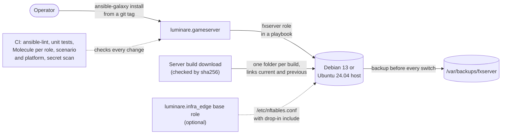

<!-- header:begin: brand-repos 0.1.0, variant studio, files in https://raw.githubusercontent.com/luminare-dev/ansible-collection-gameserver/main/docs/brand/; the project-page sync drops this block -->
<picture>
  <source media="(prefers-color-scheme: dark)" srcset="https://raw.githubusercontent.com/luminare-dev/ansible-collection-gameserver/main/docs/brand/readme-header-dark.svg">
  <source media="(prefers-color-scheme: light)" srcset="https://raw.githubusercontent.com/luminare-dev/ansible-collection-gameserver/main/docs/brand/readme-header-light.svg">
  
</picture>

<!-- byline:studio -->
*a [Luminare Development](https://luminare.tech/open-source/ansible-collection-gameserver/) open-source project*
<!-- /byline:studio -->
<!-- byline:personal
*by [ItsPaulAT](https://github.com/ItsPaulAT) · [project page](https://luminare.tech/open-source/ansible-collection-gameserver/)*
/byline:personal -->
<!-- header:end -->

# luminare.gameserver

Ansible roles that install, configure, update and back up game servers, for FiveM/RedM servers (FXServer).

[](https://github.com/luminare-dev/ansible-collection-gameserver/actions/workflows/ci.yml)
[](https://github.com/luminare-dev/ansible-collection-gameserver/releases)
[](LICENSE)
[](https://scorecard.dev/viewer/?uri=github.com/luminare-dev/ansible-collection-gameserver)

## Why

Running a FiveM or RedM server (FXServer) on Linux by hand is a list of steps that are easy to get
wrong: download a server build, create a service user and a systemd unit, keep the admin port off
the internet, keep the license key out of git, update every few weeks and keep a way back. This
Ansible collection turns that list into roles, and it holds every role to the same test bar:
Molecule scenarios that CI runs on Debian 13 and Ubuntu 24.04 in systemd containers with an
idempotence check, ansible-lint with its production profile, and a secret scan that recognises
server license keys.

## Quickstart

Install the collection from a release tag with `ansible-galaxy` (needs `git` on the controller):

<!-- x-release-please-start-version -->
```bash
ansible-galaxy collection install git+https://github.com/luminare-dev/ansible-collection-gameserver.git,v0.1.0
ansible-galaxy collection list luminare.gameserver
```
<!-- x-release-please-end -->

Each release also carries the collection tarball and `SHA256SUMS`; see
[Installation](docs/install.md) for that path and for a `requirements.yml` entry.

## How it works



| Role | What it does |
|---|---|
| [`fxserver`](roles/fxserver/README.md) | Installs a server build checked against its sha256 and runs it as a hardened systemd unit (user `fxserver`, `/opt/fxserver`); switches builds with one rename, checks `/info.json` after every switch and rolls a failed update back; backs up server-data and txData (zstd tar) before every switch and optionally every night; writes `secrets.cfg` (0600; `/perf/` always behind basic auth, with a random password when none is set), the game port drop-in `45-fxserver.nft`, a journald retention and textfile metrics. |

- **Roles** go into `roles/<role>/`, each with a Molecule scenario in
  `roles/<role>/molecule/default/` and optional further scenarios (`fxserver` has `upgrade`); a
  role directory without a default scenario fails the `plan` job and the unit tests. The tests
  use a fake server build (`tests/fake-artifact/`), never a real one.
- **Tests:** every scenario reuses one base configuration (`.config/molecule/config.yml`) and one
  test image (`molecule/resources/Dockerfile.j2`: `debian:trixie` or `ubuntu:24.04`, pinned by
  digest, with systemd as PID 1). Instance names start with `gs-`. The sequence is dependency,
  syntax, create, prepare, converge, idempotence (must report `changed=0`), verify and destroy;
  the `upgrade` scenario adds a side_effect step for the update and rollback.
- **CI:** the `plan` job builds a matrix with one entry for each scenario of each role on each
  platform (Debian 13 and Ubuntu 24.04). Each `molecule-scenario (<role>, <scenario>, <platform>)`
  job runs `molecule test --scenario-name <scenario> --platform-name <instance>` with a 30-minute
  limit, on pull requests, by hand and every Tuesday. The `molecule` job reports one result for
  all of them; it fails when a scenario fails and passes when there is none. The `lint-test` job runs ansible-lint
  (production profile) and the unit tests through `scripts/test.sh`. The Python tools come from
  the hash-pinned `requirements-test.txt`.
- **Releases:** release-please tags `vX.Y.Z` and updates the version in `galaxy.yml`. The release
  then attaches the source archive, the collection tarball built by `ansible-galaxy collection
  build` (`luminare-gameserver-X.Y.Z.tar.gz`) and one `SHA256SUMS` file for both.

### Works with luminare.infra_edge

This collection does not list
[luminare.infra_edge](https://github.com/luminare-dev/ansible-collection-infra_edge) as a
dependency in `galaxy.yml`. The roles here follow that collection's firewall layout, in which the
infra_edge `base` role owns `/etc/nftables.conf` and other roles add drop-in files; the
convention is recorded in
[ADR 0008](docs/adr/0008-soft-dependency-on-the-infra-edge-firewall-layout.md). The `fxserver`
role writes `/etc/nftables.d/45-fxserver.nft` (accept rules for the game port only) when that
directory exists or `fxserver_firewall_manage` is `true`, and checks it with `nft --check`
together with `/etc/nftables.conf` before it replaces the old file. It requires
`table inet filter` and the line `include "/etc/nftables.d/*.nft"` in `/etc/nftables.conf` and
stops before any change without them: the nftables package's own `/etc/nftables.conf` has no
such line, so a drop-in would pass `nft --check` but never be loaded.

## Design decisions

The decisions behind this project are recorded as short ADRs in [docs/adr/](docs/adr/):

- [ADR 0001: Record architecture decisions](docs/adr/0001-record-architecture-decisions.md)
- [ADR 0002: Pin every action and downloaded tool](docs/adr/0002-pin-actions-and-downloaded-tools.md)
- [ADR 0003: Secret scanning with the gitleaks binary](docs/adr/0003-secret-scanning-with-the-gitleaks-binary.md)
- [ADR 0004: Draft releases with checksums and provenance](docs/adr/0004-draft-releases-with-checksums-and-provenance.md)
- [ADR 0005: Why git tags and release tarballs instead of a registry install](docs/adr/0005-install-from-git-tags-and-release-tarballs.md)
- [ADR 0006: Why Molecule in systemd containers, one CI job per role and platform](docs/adr/0006-molecule-in-systemd-containers-one-job-per-role-and-platform.md)
- [ADR 0007: Why `requires_ansible` names only tested versions](docs/adr/0007-requires-ansible-from-tested-versions-only.md)
- [ADR 0008: Why a soft dependency on the infra_edge firewall layout](docs/adr/0008-soft-dependency-on-the-infra-edge-firewall-layout.md)
- [ADR 0009: Why one hash-pinned toolchain for lint, Molecule and the release](docs/adr/0009-one-hash-pinned-test-toolchain.md)
- [ADR 0010: Why the secret scan catches license keys of any layout](docs/adr/0010-catch-license-keys-of-any-layout.md)
- [ADR 0011: Why a service user `fxserver` and one directory layout](docs/adr/0011-service-user-fxserver-and-one-directory-layout.md)
- [ADR 0012: Why builds are switched with one rename, checked and rolled back](docs/adr/0012-switch-builds-with-one-rename-check-and-roll-back.md)
- [ADR 0013: Why local backups before every switch, and off-host copies with any tool](docs/adr/0013-local-backups-before-every-switch.md)
- [ADR 0014: Why the tests use a fake build and one CI job per scenario](docs/adr/0014-fake-build-and-one-ci-job-per-scenario.md)

## Supported versions

| Component | Tested with | Supported |
|---|---|---|
| ansible-core (controller) | 2.21.5 | 2.21 and later (`meta/runtime.yml`: `>=2.21.0`) |
| Python (controller) | 3.12 (the CI runner's version, in `python:3.12-slim`) and 3.14 | 3.12 and later, as ansible-core 2.21 requires |
| Debian 13 "trixie" (managed host) | Molecule image from `debian:trixie`, pinned by digest | primary platform |
| Ubuntu 24.04 "noble" (managed host) | Molecule image from `ubuntu:24.04`, pinned by digest | second platform |
| Server build (`fxserver` role) | a fake build in Molecule; the default is the Recommended build 35245 of 2026-10-21 | Linux x86_64 builds; run the current Recommended build ([upgrade guide](docs/upgrade.md#which-build-to-run)) |
| Test tools | ansible-lint 26.10.1, Molecule 26.10.0, molecule-plugins[docker] 26.10.12 | as pinned in `requirements-test.txt` |

Fixes go into the latest minor release only. See the
[security policy](https://github.com/luminare-dev/.github/blob/main/SECURITY.md) for reporting.

## Limitations

- The `fxserver` role is tested only with a fake server build (`tests/fake-artifact/`). No run
  with a real server build has been made, keyed or in LAN mode (`sv_lan`, which according to the
  platform documentation skips the license key check): whether the hardened unit
  (`ProtectSystem=strict`, `NoNewPrivileges` and the others) suits a real build, whether players
  can connect, whether a real build refuses `/perf/` without credentials, and the end-to-end run
  on a fresh cloud server (two runs with `changed=0`, `/info.json` from the host, the game port
  from outside) are still open.
- The server runs directly with `server.cfg`; this version has no role for the txAdmin panel.
- Molecule runs in privileged systemd containers, not on virtual machines or cloud servers.
  Kernel-level behaviour, such as a loaded nftables ruleset, is not proven by these tests: the
  game port drop-in is validated with `nft --check`, but not loaded.
- Backups stay on the host (`/var/backups/fxserver`); copies elsewhere, for example with restic,
  are up to the operator (paths in the [role README](roles/fxserver/README.md#backups)).
- A server with a valid license key appears in the public server list unless it runs LAN-only
  (`fxserver_cfg` key `lan: true`, which writes `sv_lan true`; tested with the fake build only).
  According to the platform documentation, `sv_master1 ""` (the default
  `master1_disabled: true`) only disables the connect button and cannot de-list a server, so
  outside LAN mode the name and description of a test server are public too: give it a neutral
  `hostname`, `project_name` and `project_desc`.
- Only ansible-core 2.21 is tested; older releases are not declared as supported.
- Managed hosts other than Debian 13 and Ubuntu 24.04 on x86_64 are not tested.
- The collection is not published on Ansible Galaxy, so `ansible-galaxy collection install
  luminare.gameserver` by name does not work: install it from a git tag or the release tarball
  ([ADR 0005](docs/adr/0005-install-from-git-tags-and-release-tarballs.md)). The `luminare`
  namespace has not been requested on Galaxy. If Galaxy does not grant it, the collection is
  renamed `luminare_dev.gameserver`, which changes every fully qualified name
  (`luminare.gameserver.<role>`) in your playbooks; that rename ships as a breaking change with
  upgrade notes.
- The `molecule` check is not a required check, and pushes to `main` skip the scenarios, so
  `main` itself is tested by the weekly scheduled run or a manual run.

## Results

Measured in this repository on 2026-10-21; the rows marked 2026-10-22 were measured on that day.

| What | Value | How it was measured |
|---|---|---|
| Molecule `fxserver` `default` (2026-10-22) | passed on Debian 13 and Ubuntu 24.04; idempotence `changed=0` on both; the restore of the newest backup as in the runbook checked (owners, modes, `secrets.cfg`, the server answers again); 4 min 17 s for both platforms | `molecule test` in `roles/fxserver` (Molecule 26.10.0, ansible-core 2.21.5), both instances in one run, test images already in the Docker build cache, another scenario running at the same time; wall time of the `molecule test` command |
| Molecule `fxserver` `upgrade` (2026-10-22) | passed on Debian 13 and Ubuntu 24.04, with Ansible connecting as a non-root user with sudo and no `/perf/` password set; idempotence `changed=0` on both; update together with a new server-data commit (the pre-update backup holds the old `server.cfg`), refused switch after a failed backup, five runs stopped at their checks (drop-in directory without `/etc/nftables.conf`, `/etc/nftables.conf` without the drop-in include, a quote, a line break and a resource name in `fxserver_cfg`), automatic rollback of the broken build, rollback by build number, the removed deploy key, and `/perf/` refusing a request without credentials and answering with the random password from `secrets.cfg` all checked; 9 min 58 s for both platforms | `molecule test -s upgrade` in `roles/fxserver`, same tools and method |
| Unit tests (2026-10-22) | 143 run: 142 passed, 1 skipped (a check that applies only to the template repository) | `python3 -m unittest discover -s tests` with gitleaks 8.30.1 and markdownlint-cli2 0.23.2 on the PATH, Python 3.14.3 |
| ansible-lint (2026-10-22) | 0 failures, 0 warnings in 67 files; profile `production` passed | `ansible-lint` from the repository root, ansible-lint 26.10.1 with ansible-core 2.21.5 |
| Collection tarball (2026-10-22) | `luminare-gameserver-0.0.0.tar.gz`: 69 entries, about 56.7 kB (1 kB = 1000 bytes); the `fxserver` role without its Molecule scenarios; no `docs/brand/`, scripts, unit tests, fake build or Molecule files | `ansible-galaxy collection build` (ansible-core 2.21.5) twice from a fresh copy of the tree, then `tar -tzf` and the file size; the size varies by a few bytes between builds, because the archive stores file and build times |
| Hash-pinned test tools | 45 packages installed, `pip check` clean | `pip install --require-hashes --only-binary=:all: -r requirements-test.txt` in a `python:3.12-slim` container |
| Release build (2026-10-22) | `ansible-collection-gameserver-0.1.0.tar.gz` and `luminare-gameserver-0.1.0.tar.gz`, one `SHA256SUMS` that verifies both; the test-command passed (143 unit tests, 2 skipped: the template-only check and the markdownlint test); with `galaxy.yml` left at 0.0.0 the step fails (2026-10-21) | `release.yml`'s test-command (with `CI=true`, so with the hash-pinned tools and the pinned gitleaks) and extra-dist-command in `python:3.12-slim` (Python 3.12.15), on a local `v0.1.0` tag with the release-please version edits applied by hand |
| Install paths | git URL with a ref, `requirements.yml` with `type: git`, and the tarball: each installs `luminare.gameserver` | `ansible-galaxy collection install` against a local clone (`file://` URL) and the locally built tarball |

## Documentation and links

- [Installation](docs/install.md) · [Configuration](docs/configuration.md) ·
  [Upgrade](docs/upgrade.md) · [Troubleshooting](docs/troubleshooting.md) ·
  [Runbook](docs/runbook.md) · [ADRs](docs/adr/)
- [Changelog](CHANGELOG.md) and [releases](https://github.com/luminare-dev/ansible-collection-gameserver/releases)
  (each release has the source archive, the collection tarball, `SHA256SUMS` and a build
  provenance attestation)
- [Contributing](https://github.com/luminare-dev/.github/blob/main/CONTRIBUTING.md) ·
  [Code of conduct](https://github.com/luminare-dev/.github/blob/main/CODE_OF_CONDUCT.md) ·
  [Security](https://github.com/luminare-dev/.github/blob/main/SECURITY.md) ·
  [Support](https://github.com/luminare-dev/.github/blob/main/SUPPORT.md)
- Project page: <https://luminare.tech/open-source/ansible-collection-gameserver/>

<!-- fxserver:begin -->
## Not affiliated

Not affiliated with or endorsed by Cfx.re, Rockstar Games or Take-Two. FiveM, RedM and FXServer
are named only to describe what this project works with.
<!-- fxserver:end -->

## Licence

[Apache-2.0](LICENSE). The licence covers the code only: the project name, logo, header images
and `docs/brand/` are not licensed (see [NOTICE](NOTICE)).

<!-- byline:studio -->
*a [Luminare Development](https://luminare.tech/open-source/ansible-collection-gameserver/) open-source project*
<!-- /byline:studio -->
<!-- byline:personal
*by [ItsPaulAT](https://github.com/ItsPaulAT) · [project page](https://luminare.tech/open-source/ansible-collection-gameserver/)*
/byline:personal -->
